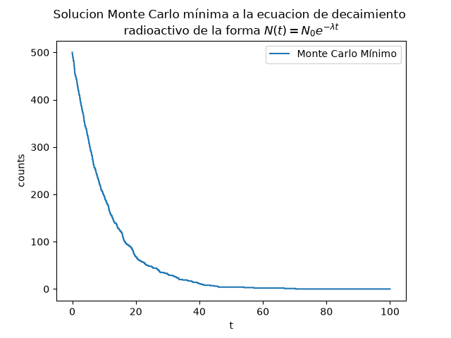
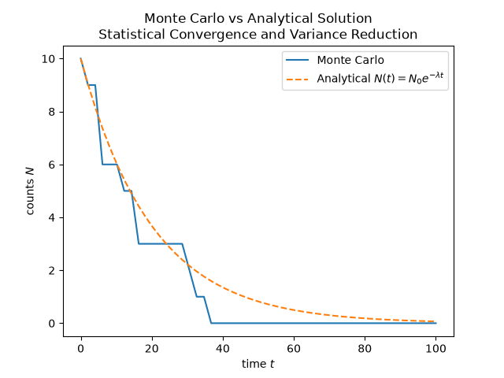

# Monte Carlo Simulation

Repositorio educativo para comprender el método de Monte Carlo desde cero, avanzando desde ejemplos mínimos de decaimiento probabilístico hasta una simulación de transporte de partículas en geometría unidimensional.

## Estado actual del proyecto

El proyecto ya no es solo un ejercicio introductorio: cuenta con una estructura modular, ejemplos ejecutables y una base de simulación que representa una geometría de placa (`slab`) y el transporte de partículas en ella. Actualmente incluye:

- generador de números aleatorios basado en XorShift64*
- distribución exponencial para longitudes de libre recorrido
- material con secciones eficaces de absorción y dispersión
- fuente fija de partículas
- tally de flujo por longitud de trayectoria
- simulación de transporte con absorción y dispersión
- pruebas unitarias para geometría, partículas, RNG y transporte
- ejemplos visuales para decaimiento y flujo en una placa

## Avances destacados

### 1. Evolución desde el ejemplo mínimo

La primera etapa del proyecto consistió en un modelo sencillo de decaimiento probabilístico, donde se generaban tiempos de vida aleatorios para determinar qué partículas desaparecían a lo largo del tiempo.



Ese enfoque sirvió como introducción a la idea de Monte Carlo y a la interpretación de la varianza estadística en una simulación.

### 2. Comparación con solución analítica

La siguiente etapa incorporó un modelo continuo de decaimiento con comparación directa entre simulación y solución analítica, además de visualización de convergencia estadística y reducción de varianza.



Esto permitió estudiar cómo la simulación se aproxima a la solución exacta conforme aumenta el número de realizaciones.

### 3. Implementación de transporte de partículas

El núcleo actual del proyecto está en la carpeta `mc/`, donde se modela una simulación de transporte 1D:

- `mc/geometry/slab.py`: geometría de placa con cálculo de distancia a la frontera
- `mc/particle/particle.py`: estado de la partícula
- `mc/physics/material.py`: definición de secciones eficaces
- `mc/physics/interactions.py`: selección de colisión, libre recorrido y dispersión
- `mc/rng/generator.py`: algoritmo aleatorio
- `mc/rng/distributions.py`: distribución exponencial
- `mc/source/source.py`: fuente fija de neutrones o partículas
- `mc/tally/flux.py`: estimación de flujo mediante track-length
- `mc/simulation/simulation.py`: orquestación general de la simulación
- `mc/transport/transport.py`: evolución de la partícula dentro del material y la geometría

### 4. Validación con pruebas

Se agregó una suite de pruebas para verificar el comportamiento básico del proyecto:

- geometría y distancia a los límites
- estado inicial de la partícula
- generación aleatoria y distribución exponencial
- ejecución del transporte y acotación del tally

Esto mejora la reproducibilidad y sirve como base para extender el proyecto con nuevos fenómenos físicos.

## Estructura del repositorio

```text
MonteCarlo/
├── MC_continuo/                 # ejemplos de decaimiento continuo y visualizaciones
│   ├── main.py
│   ├── mc_continuo.py
│   └── graphs/
├── MC_minimo/                  # versión inicial del método Monte Carlo mínimo
│   ├── decay_minimo.png
│   └── mc_minimo.py
├── examples/
│   └── slab_transport.py       # ejemplo ejecutable de transporte 1D
├── mc/                         # biblioteca principal del proyecto
│   ├── geometry/
│   ├── particle/
│   ├── physics/
│   ├── rng/
│   ├── simulation/
│   ├── source/
│   ├── tally/
│   └── transport/
├── tests/                      # pruebas unitarias
├── README.md
└── ...
```

## Cómo ejecutar ejemplos

### Transporte en una placa

```bash
python examples/slab_transport.py
```

Este ejemplo crea una geometría `Slab(0.0, 10.0)`, define un material con secciones de absorción y dispersión, genera una partícula desde una fuente fija, ejecuta la simulación y dibuja el perfil de flujo estimado.

### Decaimiento continuo

```bash
cd MC_continuo
python main.py
```

Esto genera múltiples imágenes de comparación entre Monte Carlo y la solución analítica del decaimiento exponencial y compone la animación final.

## Objetivo del proyecto

El proyecto busca ser una referencia pedagógica para entender:

- la relación entre aleatoriedad y modelos físicos
- la construcción de simulaciones Monte Carlo paso a paso
- la importancia de la estadística y la convergencia
- la transición de ejemplos mínimos a modelos más realistas de transporte de radiación o partículas

Con el estado actual, el repositorio queda como una base sólida para seguir ampliando capacidades como:

- geometrías más complejas
- múltiples materiales y regiones
- fuentes distribuidas
- estimadores de flujo, dosis y reacción
- técnicas de reducción de varianza
- integración con visualización más avanzada

## Resumen

El proyecto ha pasado de una demostración inicial de decaimiento probabilístico a una biblioteca modular de transporte de partículas en geometría 1D; la base ya está estable, documentada y validada con pruebas, lo que la convierte en un punto de partida muy útil para continuar aprendiendo y desarrollando modelos Monte Carlo más completos.
